# CS184/284A Fall 2026 Homework 2 Write-Up

Names: Bharagth Ravindhran

Link to webpage: https://cal-cs184-student.github.io/hw2-bha-writeup/

Link to GitHub repository: https://github.com/cal-cs184-student/hw2-bha

## Overview

### What I built
- I built Bezier curve and surface evaluation with de Casteljau subdivision, along with a set of triangle mesh operations on the half-edge data structure: area-weighted vertex normals, edge flips, edge splits, and Loop subdivision upsampling.
- Everything lives in `src/student_code.cpp`. That meant `BezierCurve::evaluateStep`, three `BezierPatch` evaluators, `Vertex::normal`, `HalfedgeMesh::flipEdge` and `splitEdge`, and `MeshResampler::upsample`, all working through the viewer I already had from the starter code.

### My approach per part
- Part 1: I implemented a single de Casteljau level as `p_i' = (1-t) p_i + t p_{i+1}` over adjacent pairs, since the GUI itself handles the recursion by calling it once per `E` press until one point remains.
- Part 2: I reused the 1D step for surfaces separably. Each control-point row is just a Bezier curve in `u`, and the row results form one more curve in `v`, so no new math was needed beyond Part 1.
- Part 3: I summed face normals around each vertex fan, weighting by area using the cross product magnitude, then normalized. I used const iterators throughout and skipped the virtual boundary faces, which are not real triangles.
- Part 4: I drew the before and after diamonds on paper with every halfedge labeled, then rewired all six halfedges with `setNeighbors` plus every touched vertex, edge, and face pointer, even the ones that looked unchanged.
- Part 5: I inserted the midpoint vertex and built the 3 edges, 2 faces, and 6 halfedges around it, turning 2 triangles into 4, with the new vertex pointing back along the split edge as the spec requires.
- Part 6: I computed all Loop positions on the coarse mesh first, since the weights have to come from the original positions, then did the split-and-flip connectivity pass, and committed positions last.

### Problems and fixes
- Part 4: single flips looked perfect on the teapot, so a passing glance would have stopped there. Instead I flipped the same edge twice and checked the face connectivity came back exactly, which is what caught pointer mistakes my eyes had missed.
- Part 4: flipping every edge of a small test cube one after another broke the mesh at flip 12. I traced it to flips where both opposite vertices coincide (`va == vd`), which would stitch an edge from a vertex to itself, and added an early return for that case. A single flip in the viewer never hits it, but the guard makes repeated flipping safe.
- Part 6: my symmetrized cube screenshot showed dark slivers poking past the silhouette. I traced those to flipping a bent 90-degree corner quad, which folds a triangle geometrically while staying valid topologically. The spec notes darker post-flip triangles are acceptable, so I kept the screenshot and learned to pre-flip only flat face diagonals.
- Part 6: the stock cube subdivided lopsided, which was confusing until I looked at the wireframe and saw each square face's diagonal running an arbitrary direction. Once I aligned the diagonals with flips first, the same subdivision came out symmetric, which confirmed the triangulation, not the weights, was the culprit.

### What I learned
- Everything in the second half of this homework came down to half-edges. Vertices, edges, and faces each store just one half-edge, so all traversal and editing goes through next, twin, and vertex pointers. Once I learned that a vertex points to an outgoing half-edge and a face points to one of its loop, I could predict each pointer update instead of guessing. The fan walk `h = h->twin()->next()` is a good example: it looks cryptic at first, but each step just hops across an edge and around to the next outgoing half-edge, so circling a vertex falls out naturally.
- I was surprised that Loop subdivision is really two separate jobs. The split-and-flip pass only changes connectivity, quadrupling every triangle without moving a single point, while all the smoothing comes from weighted averages worked out beforehand, like `3/8` and `1/8` around each edge and `3/(8n)` around each old vertex. Computing those weights on the coarse mesh and committing them last kept the code much easier to get right than mixing movement into the rewiring.
- I learned that one good render proves very little. A single flip looked perfect on the teapot, but trying flips all over a small cube exposed a degenerate case where both opposite vertices are the same vertex, which would stitch an edge from a vertex to itself. It took a one-line early return to guard, plus a flip-twice check to confirm a flip exactly undoes itself, but I only found either by testing beyond the cases I actually needed.

## Section I: Bezier Curves and Surfaces

### Part 1: Bezier curves with 1D de Casteljau subdivision
- De Casteljau evaluates a Bezier curve at `t` by repeated linear interpolation. Following Lecture 7, I treated one level as taking `n` points to `n-1` points with `p_i' = (1-t) p_i + t p_{i+1}`, so applying the step until one point remains lands exactly on the curve at `t`.
- I implemented exactly one such level in `BezierCurve::evaluateStep` in `src/student_code.cpp`, looping `i = 0..n-2` and pushing `(1-t) * points[i] + t * points[i+1]` with the member `t`. The viewer calls it once per `E` press to walk down the levels, and `C` draws the finished curve by sampling `t` across `[0,1]`.
- I created `bzc/curve_custom6.bzc` with 6 control points in an S-shape: `0.15 0.30, 0.25 0.65, 0.45 0.80, 0.65 0.55, 0.80 0.70, 0.90 0.40`. I deliberately zigzagged the heights, since collinear points would collapse every intermediate level onto nearly the same line and hide the subdivision the screenshots are meant to show.
- Figures 1 through 6 press `E` from the 6 white control points down through 5, 4, 3, and 2 blue intermediates to the single red evaluated point at the default `t = 0.5`. Figure 7 toggles `C` so the green finished curve appears behind the scaffolding, and Figure 8 drags a white control point elsewhere and scrolls `t` so the whole construction slides along a visibly different curve.

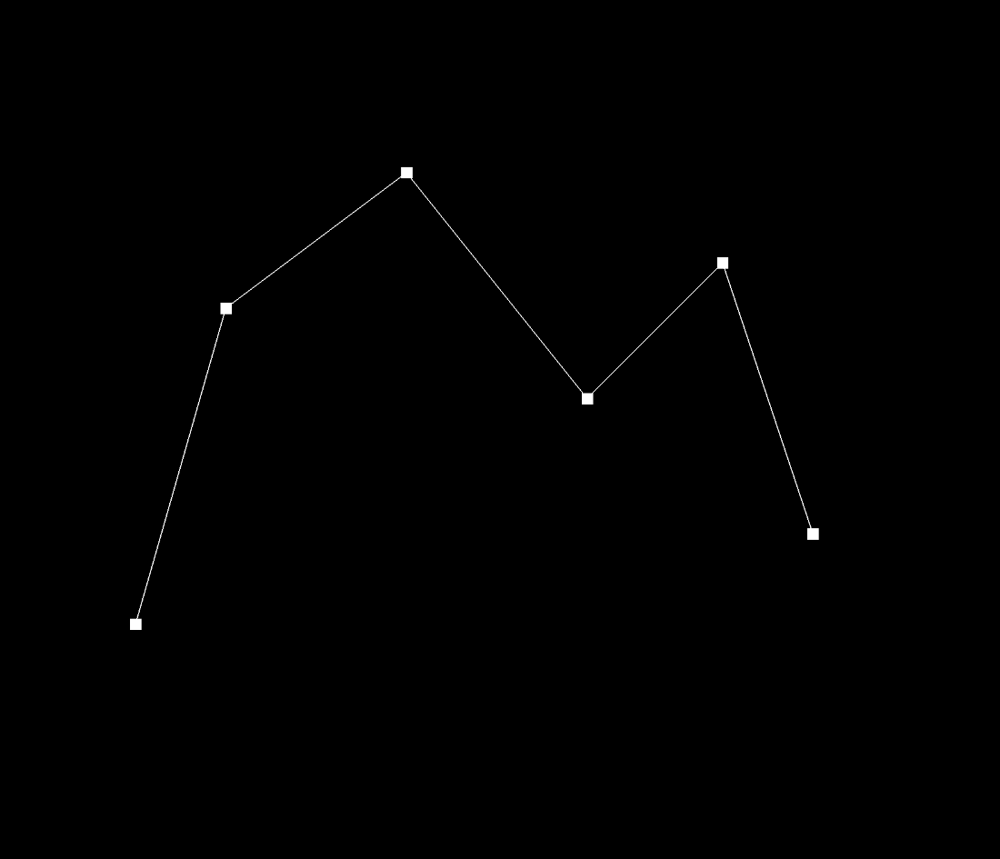
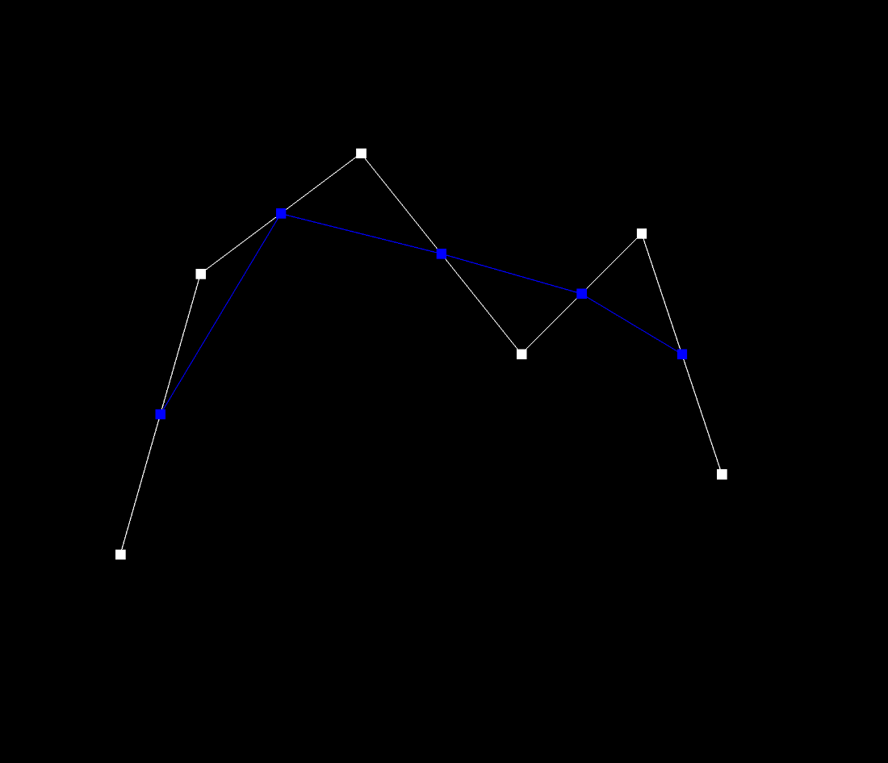

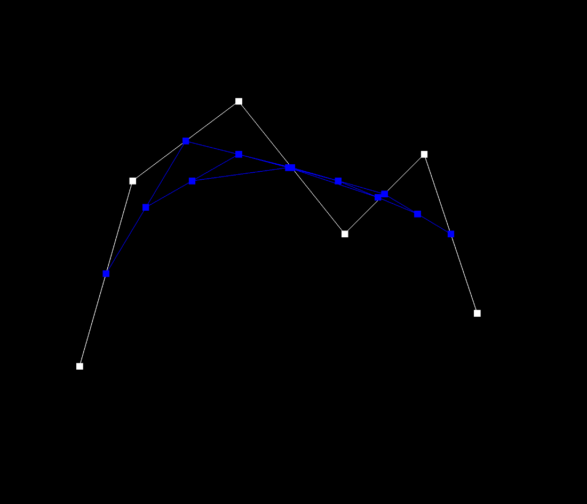

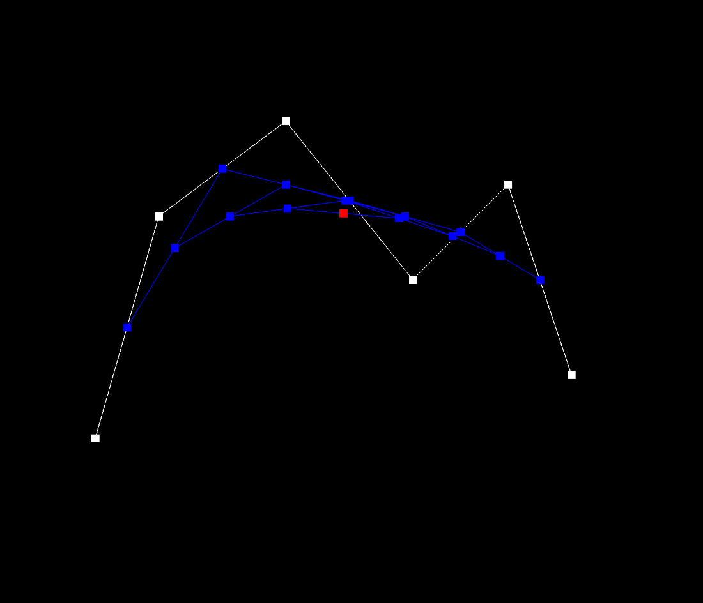
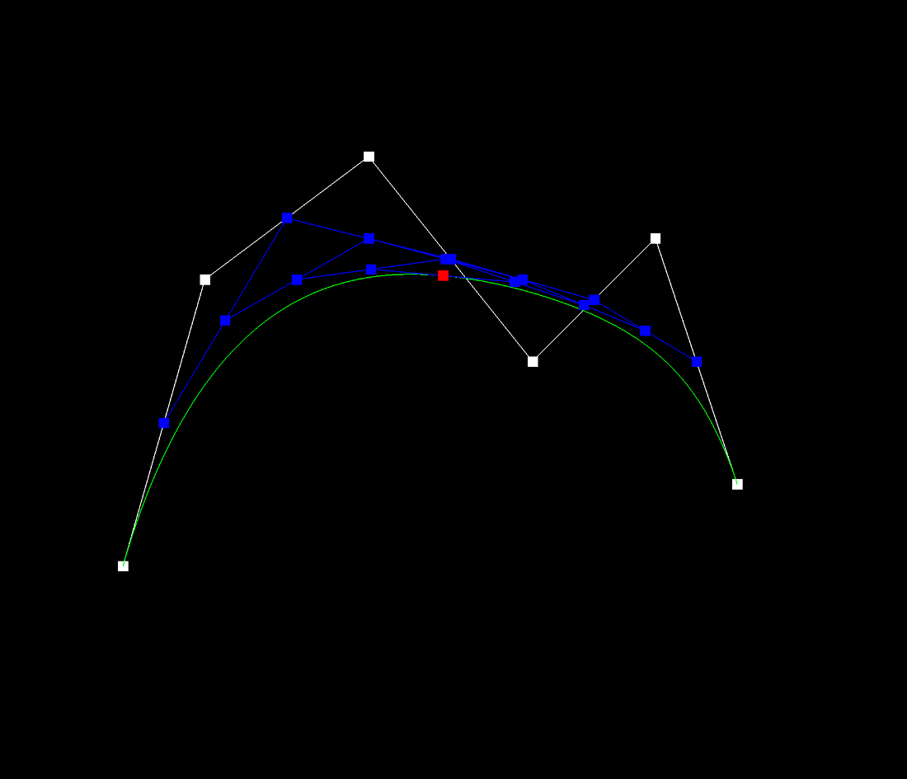
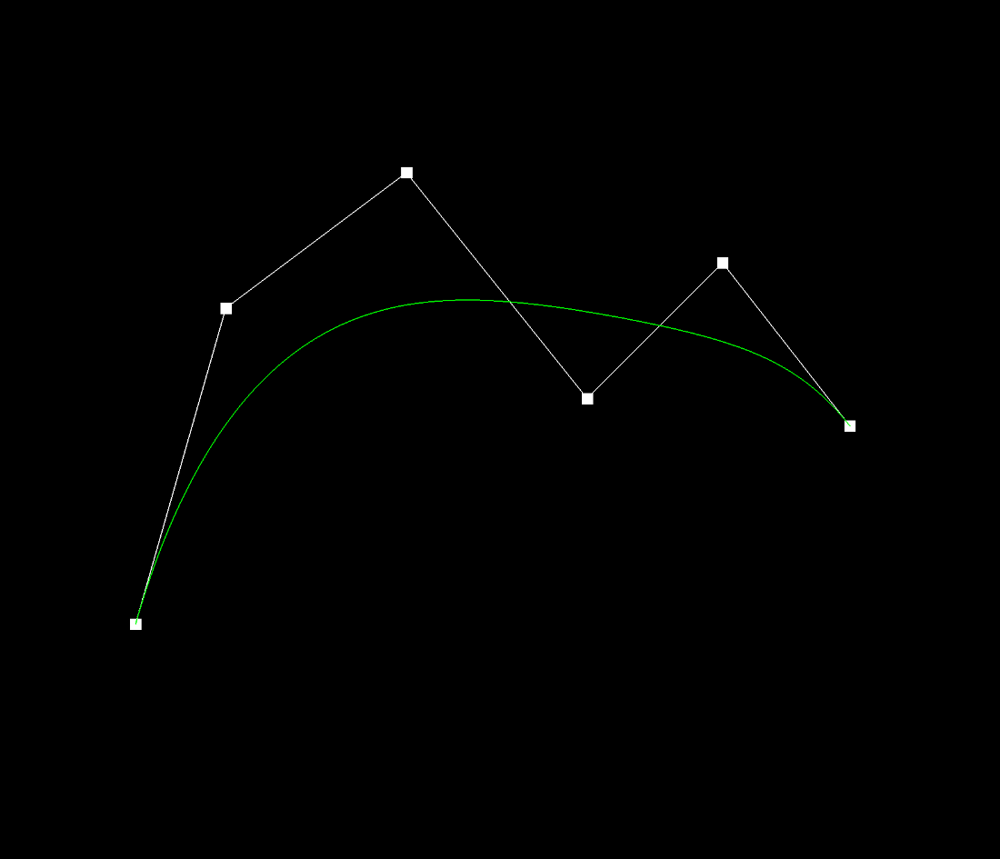

### Part 2: Bezier surfaces with separable 1D de Casteljau
- A Bezier surface reduces to curve evaluations applied separably. Each of the `n` control-point rows is just a Bezier curve in `u`, and the `n` evaluated row points form one final curve in `v` whose point lies on the surface, which the lecture slide draws as rows collapsing into a column.
- I implemented `BezierPatch::evaluateStep` exactly like Part 1 but with parameter `t`, `BezierPatch::evaluate1D` looping that step down to a single point, and `BezierPatch::evaluate(u, v)` evaluating every row of `controlPoints` at `u` and then that column at `v`, all in `src/student_code.cpp`.
- Figure 9 shows `bez/teapot.bez` rendered through my evaluator. The spout, handle, lid, and knob all come through as a smooth closed teapot, which confirmed both parameter directions were right, since swapping `u` and `v` would have twisted it.

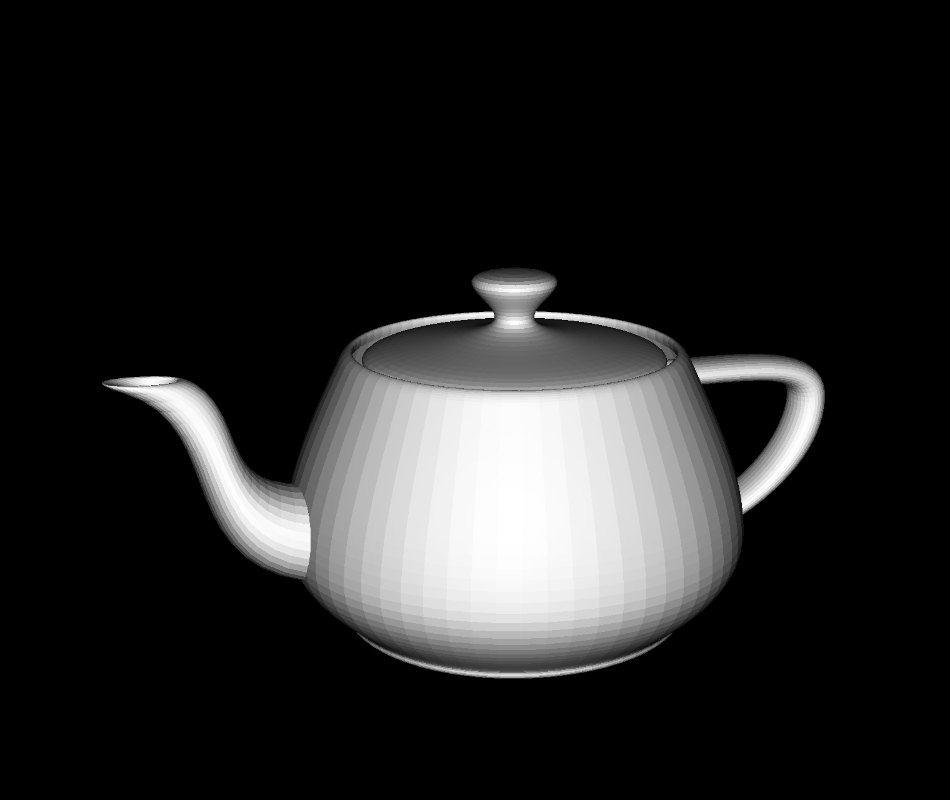

## Section II: Triangle Meshes and Half-Edge Data Structure

### Part 3: Area-weighted vertex normals
- I walk the fan around each vertex with `h = h->twin()->next()` starting from `halfedge()`, the same circulation the primer's neighbor example uses. For each incident face I add `cross(p1 - p0, p2 - p0)`, whose magnitude already equals twice the face area, so the sum comes out area-weighted with no separate area computation, and I return `unit()`.
- I used `HalfedgeCIter` throughout since `normal()` is const, and I skip faces where `isBoundary()` is true, because the virtual boundary face is one big polygon rather than a triangle and its cross product would be meaningless.
- Figures 10 and 11 compare `dae/teapot.dae` before and after `Q` at the same angle. The flat version shows hard banding across the body, while my normals shade it into a smooth gradient that stays bright, which told me the normals point outward as the renderer expects rather than into the model, where everything would have gone dark.

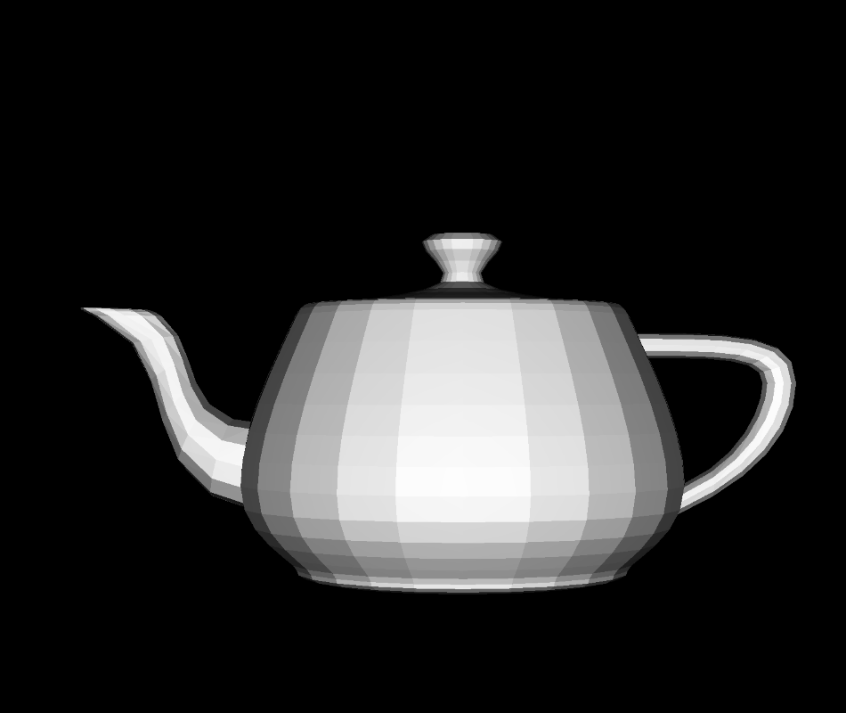

### Part 4: Edge flip
- Given triangles `(a,b,c)` and `(c,b,d)` sharing edge `(b,c)`, a flip reconnects them as `(a,d,c)` and `(a,b,d)` across the new edge `(a,d)`. I labeled the six halfedges `h0..h5` around both faces and reconnected them with `setNeighbors` into the loops `h3 -> h4 -> h1` and `h5 -> h2 -> h0`, then repointed all four vertices, the edge, and both faces, since a missed pointer segfaults far from wherever it was dropped.
- My main trick was setting *all* pointers of *every* touched element even when the target looked unchanged, because it is far easier to reason about a complete rewiring than a minimal diff. I return immediately on boundary edges, and also when both opposite vertices coincide, which would stitch an edge from a vertex to itself.
- Figures 12 and 13 show the teapot before and after `F` on the selected white edge at the same angle. The diagonal visibly changes direction with no holes opening up, and one neighboring triangle shades darker, which the spec notes is acceptable after flips.
- My debugging journey started with single flips looking perfect, which made me distrust the good news. I stress-tested by flipping every edge of a small test cube one after another while validating the mesh after each flip, and it broke at flip 12. That failure traced to the coincident-opposite-vertex case above, which my guard now rejects, and the same testing confirmed flip-twice restores connectivity exactly.

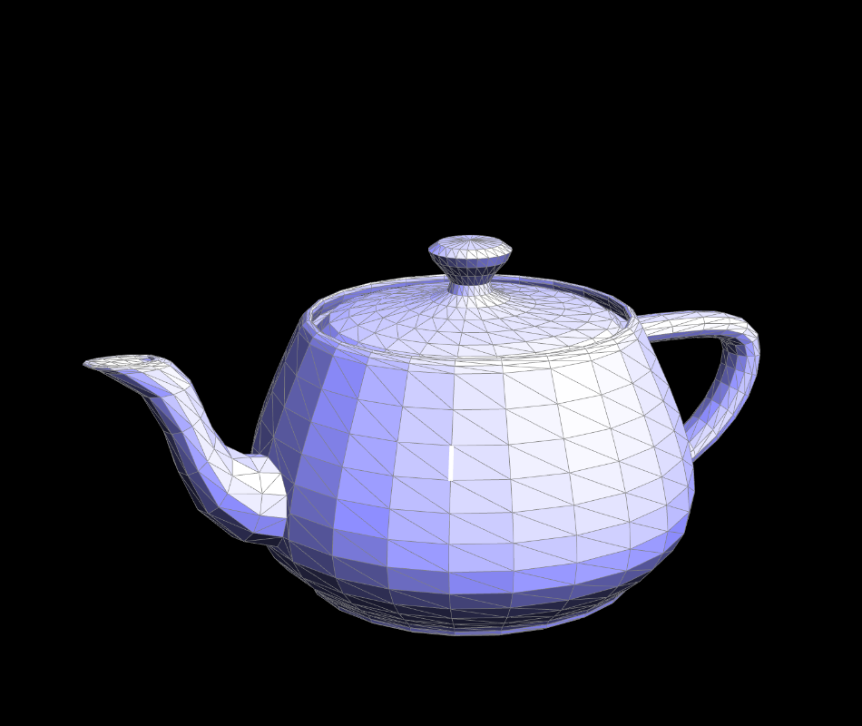

### Part 5: Edge split
- Splitting edge `(v0,v1)` between opposing vertices `va` and `vd` drops a midpoint vertex `m` and connects it to both sides, turning 2 triangles into 4: `(v0,m,va)`, `(m,v1,va)`, `(v1,m,vd)`, and `(m,v0,vd)`. Concretely I created 1 vertex, 3 edges, 2 faces, and 6 halfedges while reusing the original edge object for one half, all in `HalfedgeMesh::splitEdge`.
- I pointed `m->halfedge()` back along the split edge as the spec requires rather than at a spoke, and I flagged the new vertex and both spokes with `isNew` for Part 6 while leaving both edge halves marked old, so subdivision later flips exactly the spokes. Boundary edges return immediately.
- Figures 14 and 15 show the teapot before and after `S` without moving the camera: the app deselects automatically and the two incident triangles become four smaller ones around the new vertex, which shows up only as slightly denser triangulation at full-teapot zoom. Figure 16 flips a nearby edge first and then splits, showing the two operations compose without holes or crashes.
- Debugging Part 5 went faster because of Part 4. I also checked split-then-flip and flip-then-split on a tetrahedron with the same validity checks, and it passed on the first run, which told me my flip and split agree on how halfedges connect.

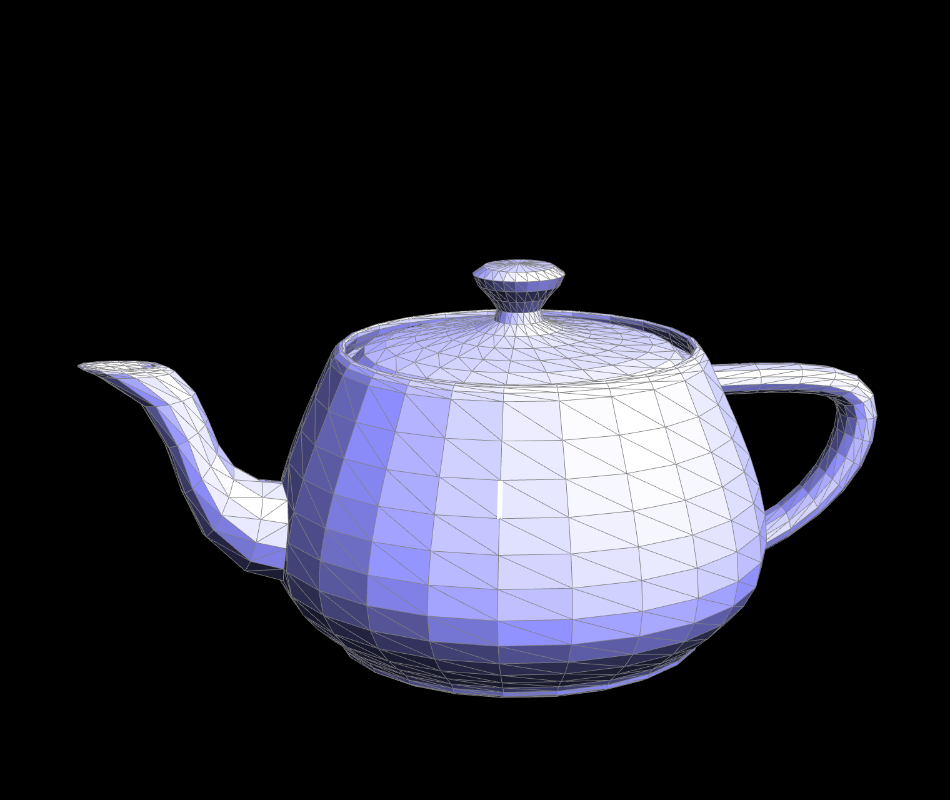

### Part 6: Loop subdivision for mesh upsampling
- Loop subdivision upsamples each triangle 4-to-1 while smoothing positions toward a limit surface. I followed the recommended order in `MeshResampler::upsample`: (A) compute positions on the coarse mesh, (B) rewire connectivity, (C) commit. Old vertices use `(1 - n*u) * pos + u * neighbor_sum` with `u = 3/16` when `n == 3` and `3/(8n)` otherwise, and new edge vertices use `3/8 * (A+B) + 1/8 * (C+D)`, all stored in `newPosition` while `position` stays untouched until the end.
- For connectivity I cached the original edge list first, since splitting while iterating would chase freshly created edges forever, then split each with `splitEdge` while copying its precomputed position onto the new vertex. I collected the new old-new spoke edges and flipped them, which the flags identify exactly, and finally copied every `newPosition` into `position`.
- Computing on the coarse mesh kept every fan traversal short, and collecting the flip list before flipping meant nothing changed while I was still deciding what to flip. Because my split marks spokes new and both halves old, the flip pass only touches spokes, which the flags identify exactly, and never the original edge lines.
- Loop rounds off anything sharp. Figures 21 and 22 compare the teapot before and after `L`: the spout tip and lid knob lose their creases as each vertex relaxes toward its neighbors. Pre-splitting an edge helps keep a crease, since the added vertices pin the surface closer to where it started.
- Figures 17 through 19 load `dae/cube.dae` and press `L` twice from the same angle: the sharp cube inflates into a lopsided rounded blob. It skews because each square face's diagonal runs an arbitrary direction, so the Loop weights follow an asymmetric triangulation. Figure 20 pre-aligns the face diagonals with `F` first and subdivides symmetrically instead. The dark slivers at its silhouette are folded triangles from flipping one bent corner quad; the mesh stays valid, and the spec notes darker post-flip triangles are fine.
- I checked the numbers instead of eyeballing: a tetrahedron goes 4 vertices, 6 edges, 4 faces to exactly 10/24/16 and then 34/96/64 across two rounds, and a cube goes 8/18/12 to 26/72/48 to 98/288/192, all with valid connectivity.

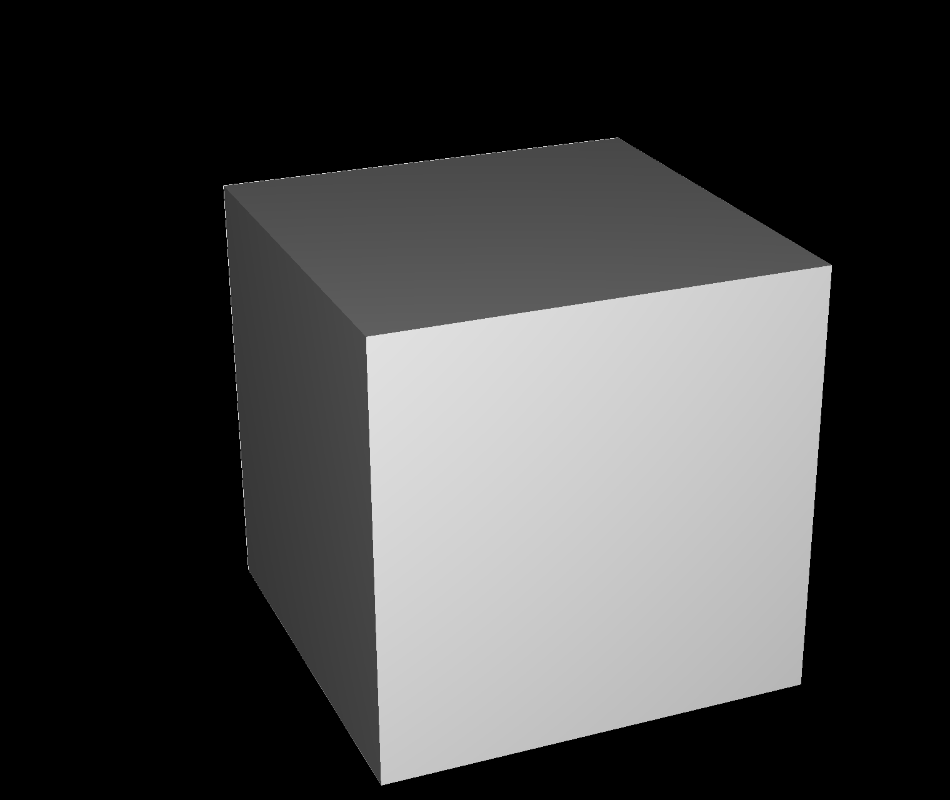
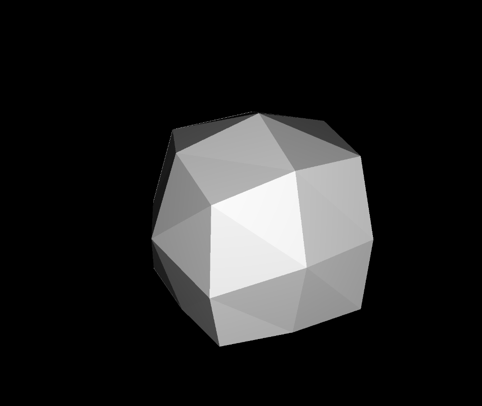
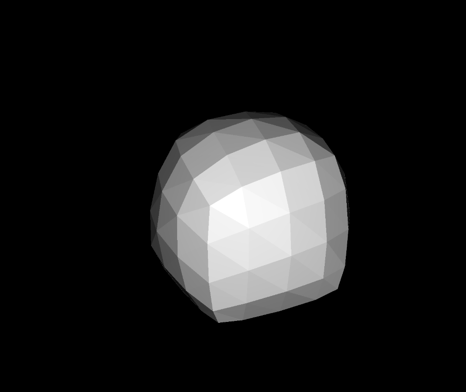
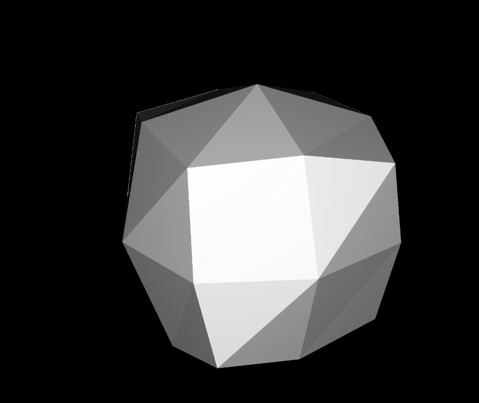
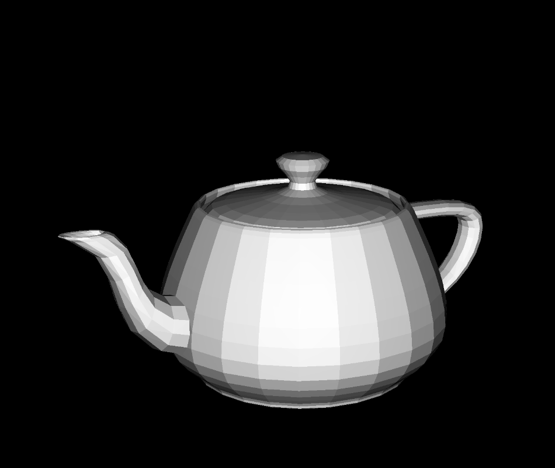
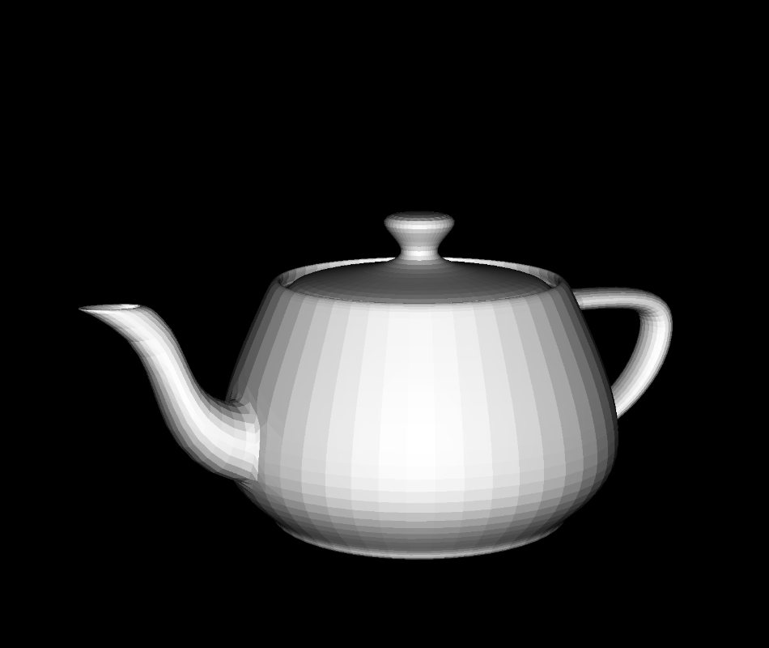

## (Optional) Section III: Art Competition
- Not attempted.
